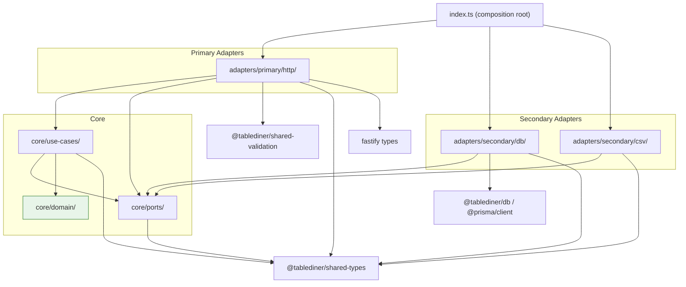

# Architecture Rules — TableDiner Monorepo

> Authoritative enforcement document. Every rule is traceable to codebase structure.  
> **Do not relax any rule without a dated DECISIONS.md entry.**

---

## Layer Overview

TableDiner uses **Hexagonal Architecture** (Ports & Adapters).  
Dependency flow is strictly inward: adapters → ports → use-cases → domain.



---

## Allowed Import Rules

| Layer | May import from |
|---|---|
| `core/domain/` | nothing — pure domain, zero external dependencies |
| `core/ports/` | `@tablediner/shared-types` only |
| `core/use-cases/` | `core/ports/`, `core/domain/`, `@tablediner/shared-types` only |
| `adapters/primary/http/` | `core/use-cases/`, `core/ports/`, `@tablediner/shared-validation`, `@tablediner/shared-types`, fastify types |
| `adapters/secondary/db/` | `core/ports/`, `@tablediner/db`, `@tablediner/shared-types`, `@prisma/client` |
| `adapters/secondary/csv/` | `core/ports/`, `@tablediner/shared-types` |
| `index.ts` | all adapters (composition root — only file allowed to wire everything) |

---

## Forbidden Patterns

### F-1 — No infrastructure leakage into core
- **NEVER** import `prisma`, `@tablediner/db`, or `@prisma/client` inside `core/use-cases/`, `core/domain/`, or `core/ports/`
- **NEVER** import fastify types anywhere inside `core/`

### F-2 — No hard deletes
- **NEVER** call `prisma.*.delete()` or `prisma.*.deleteMany()`
- Soft delete only: `update({ data: { isActive: false, deletedAt: new Date() } })`

### F-3 — No `any` in interfaces
- **NEVER** use the `any` type in port interfaces (`core/ports/`) or use-case method signatures
- Use explicit domain types or generics

### F-4 — Entity construction invariants

| Entity | Required fields on creation |
|---|---|
| Session | `tenantId`, `businessDate`, `status: 'OPEN'` |
| Order | `tenantId`, `businessDate` |
| Payment | `tenantId` |

- **NEVER** omit these fields during entity construction
- **NEVER** use `status = 'ACTIVE'` for Session — valid enum: `OPEN`, `CLOSED`, `REOPENED`, `FINALIZED`

### F-5 — Bill calculation integrity
- **NEVER** calculate bill amounts from live `MenuItem.price`
- **ALWAYS** use snapshotted `OrderItem.unitPrice` — this is intentional; menu price changes must not retroactively affect open orders

### F-6 — New API route gate
A route **MUST NOT** be merged unless ALL of the following are present:
1. Zod schema declared in `shared-validation/src/index.ts`
2. Route handler has `try/catch`
3. Unit test exists for the use case
4. Entry added to `.ai/knowledge/04-api-catalog.md`

### F-7 — DECISIONS.md write mode
- **NEVER** overwrite `.ai/DECISIONS.md` — append only
- Use `Append: true` or shell `>>` redirect

### F-8 — Secret management
- **NEVER** hardcode `AUTH_SECRET` or any credential
- Must be read from environment variable; app must fail fast at boot if missing

### F-9 — Return type purity
- **NEVER** return raw Prisma model objects from use cases
- Always map to a domain entity type or a typed DTO defined in `@tablediner/shared-types`

---

## Tenant Isolation Rules

> [!CAUTION]
> Cross-tenant data leakage is a critical security defect. Every query touching operational data must be scoped.

- All queries on `Session`, `Order`, `OrderItem`, `Payment` **MUST** include:
  ```ts
  where: { restaurantId } // or where: { tenantId }
  ```
- `findFirst()` without a tenant scope is **forbidden** except in code explicitly annotated `// MVP-ONLY`
- Do not join across tenant boundaries

---

## Money Handling Rules

- Store as Prisma `Float` (rupees, not cents)
- Display format: `₹X.XX`
- **NEVER** use integer cents
- Bill total **MUST** be computed from `OrderItem.unitPrice` (snapshotted at order time)
- `discount`, `tax`, `tip` **MUST** be stored as separate columns, not folded into `grossAmount`

---

## Error Handling Rules

Every Fastify route handler **MUST** follow this shape:

```ts
try {
  // ... use case call
} catch (err) {
  app.log.error(err);
  return reply.status(500).send({ error: 'descriptive message' });
}
```

| Failure type | HTTP status | Body shape |
|---|---|---|
| Zod parse failure | 400 | `{ error: zodError.errors[0].message }` |
| Domain invariant violation | 400 | `{ error: '<descriptive message>' }` |
| Not found | 404 | `{ error: 'Resource not found' }` |
| Unexpected / infra error | 500 | `{ error: 'descriptive message' }` |

- Domain entity method invariant violations **MUST** `throw new Error('descriptive message')`
- Catch blocks **MUST NOT** swallow errors silently

---

## Validation Rules

- All `POST` and `PATCH` request bodies **MUST** be validated with a Zod schema **before** any DB call
- Schema declaration location: `shared-validation/src/index.ts` only — **not** inline in route files
- Parse with `schema.safeParse(req.body)` — on failure return `400 { error: result.error.errors[0].message }`

---

## Soft Delete Rules

- Every archivable entity **MUST** have Prisma fields: `isActive Boolean @default(true)` and `deletedAt DateTime?`
- Soft delete implementation:
  ```ts
  prisma.entity.update({ where: { id }, data: { isActive: false, deletedAt: new Date() } })
  ```
- `ArchivableEntity` base class provides `softDelete()` and `restore()` — use them; do not duplicate logic
- All `findMany` on archivable entities **MUST** include `where: { isActive: true }`

---

## Enforcement Recommendations

| Mechanism | Rule enforced |
|---|---|
| ESLint custom rule — ban `prisma.*.delete` | F-2 |
| `noImplicitAny: true` in all `tsconfig.json` | F-3 |
| TypeScript `strict: true` in all packages | F-3, F-9 |
| Pre-commit hook: `pnpm test` | F-6 |
| CI gate: fail if test count = 0 | F-6 |
| CI gate: lint + tsc --noEmit | F-1, F-3 |
